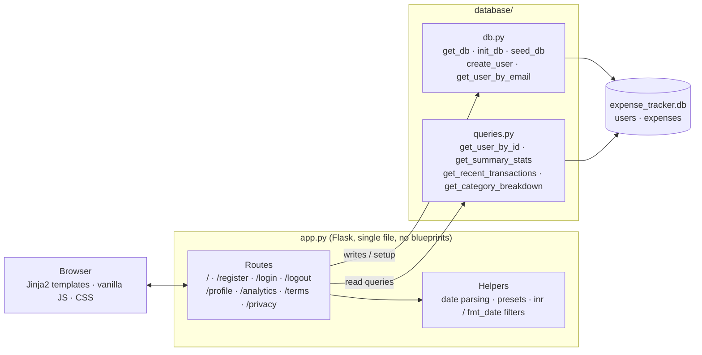
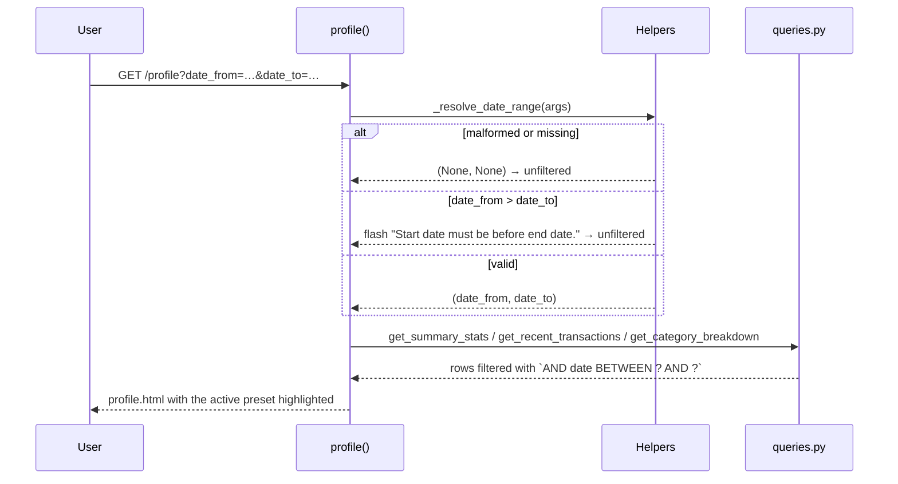

# Spendly — Personal Expense Tracker

Spendly is a lightweight personal expense tracker built with **Flask** and **SQLite**, with a vanilla-JS front end and no ORM. Users register, sign in and land on a profile page that shows **live spending stats, recent transactions and a per-category breakdown**, all filterable by date range. The project was built step by step with Claude Code, one spec per feature, with a review and testing subagent pipeline around each step.

```
Total spent       ₹366.24        8 transactions   (seeded demo data)
Top category      Bills          ₹120.00   32.8%
Filter            This Month · Last 3 Months · Last 6 Months · All Time · custom range
```

## Features

- **Accounts:** register, sign in and sign out with hashed passwords (werkzeug) and cookie sessions
- **Profile dashboard:** summary stats, recent transactions and category breakdown, with amounts shown in ₹
- **Date filter:** four quick presets plus a custom range, driven by `date_from` / `date_to` query params
- **Analytics (coming soon):** a login-only page with its own navbar link, built from a Figma design
- **Seeded demo data:** a demo user and sample expenses are created on first run

## Architecture



### How the profile filter works



Preset ranges (This Month, Last 3 Months, Last 6 Months, All Time) are computed in `app.py`, never in the template. "All Time" links to a clean `/profile` URL with no query params.

## Repository layout

```
app.py                Flask app: every route lives here (single file, no blueprints)
database/db.py        SQLite setup and writes: get_db(), init_db(), seed_db(), create_user()
database/queries.py   Read-only profile queries (no Flask imports)
templates/            Jinja2 pages, all extending base.html
static/css/           style.css (global), profile.css, analytics.css (page-specific)
static/js/main.js     Vanilla JS only
tests/                pytest suite (routes, auth, queries, date filter, analytics)
.claude/specs/        One spec per feature step, with a definition of done
.claude/agents/       Review and testing subagents (quality, security, test writer, test runner)
.claude/commands/     Slash commands: create-spec, test-feature, code-review-feature, ship-feature, …
CLAUDE.md             Project rules and conventions for Claude Code
```

## Routes

| Route | Methods | Auth | Description |
|---|---|---|---|
| `/` | GET | public | Landing page |
| `/register` | GET, POST | guests only | Create an account; signed-in users are redirected to the profile |
| `/login` | GET, POST | guests only | Sign in and start a session |
| `/logout` | GET | any | Clear the session |
| `/profile` | GET | login required | Stats, transactions and category breakdown; accepts `date_from`, `date_to` |
| `/analytics` | GET | login required | Coming-soon page; logged-out visitors are redirected to `/login` |
| `/terms`, `/privacy` | GET | public | Legal pages |
| `/expenses/add` | GET | — | Stub (Step 7) |
| `/expenses/<id>/edit` | GET | — | Stub (Step 8) |
| `/expenses/<id>/delete` | GET | — | Stub (Step 9) |

## Database

SQLite, created automatically on first run in `expense_tracker.db` (git-ignored). Foreign keys are enforced: `get_db()` runs `PRAGMA foreign_keys = ON` on every connection.

| Table | Columns |
|---|---|
| `users` | `id`, `name`, `email` (unique), `password_hash`, `created_at` |
| `expenses` | `id`, `user_id` → `users.id`, `amount`, `category`, `date` (`YYYY-MM-DD`), `description`, `created_at` |

All queries are parameterised with `?` placeholders. The seed data uses the categories Food, Transport, Bills, Health, Entertainment, Shopping and Other.

## Setup

Requires Python 3.10+.

```bash
python -m venv venv
source venv/bin/activate          # Windows: venv\Scripts\activate
pip install -r requirements.txt
python app.py                     # http://localhost:5001
```

The app runs on **port 5001**, not Flask's default 5000. On first start it creates the tables and seeds a demo user (`demo@spendly.com`; the password is set in `seed_db()` in `database/db.py`) with sample expenses. You can also register your own account.

### Dependencies

| Package | Purpose |
|---|---|
| `flask` | Web framework |
| `werkzeug` | Password hashing |
| `pytest`, `pytest-flask` | Test suite |

## Tests

```bash
pytest                       # whole suite
pytest tests/test_foo.py     # one file
pytest -k "test_name"        # one test by name
pytest -s                    # show output
```

What's covered:
- **Auth:** registration validation, duplicate emails, login, logout and session handling
- **Database:** table creation, seeding and foreign-key enforcement
- **Queries:** summary stats, recent transactions and category breakdown, with and without a date range
- **Profile:** the rendered page, ₹ formatting, the date filter presets, a custom range, reversed and malformed dates, and empty ranges
- **Analytics:** the login-only redirect, the logged-in page, and the navbar link and its active state

## Development workflow

Each feature follows the same loop, defined in `.claude/`:

1. `/create-spec` writes a spec (overview, routes, files to change, definition of done) and a feature branch
2. Claude Code implements the spec, guided by `CLAUDE.md`
3. `/test-feature` has the test-writer subagent write tests from the spec, then the test-runner subagent runs them
4. `/code-review-feature` runs the quality and security reviewers in parallel
5. `/ship-feature` commits, opens a PR, squash-merges and cleans up the branches

## Design notes and limitations

- **Single-file routes:** all routes live in `app.py` with no blueprints, and database access stays in `database/`. This is a deliberate constraint, not a gap.
- **Expense management is not built yet:** adding, editing and deleting expenses are stub routes (Steps 7–9). Expenses currently come from the seed data.
- **Analytics is a placeholder:** the page is a coming-soon screen built from a Figma design, not real charts yet.
- **Dev secret key:** `app.secret_key` is hardcoded for development. Replace it with a secret from the environment before deploying.
- **Mobile navbar:** below 600px, non-button navbar links (including Analytics) are hidden by the existing responsive rule.
- **Local data:** `expense_tracker.db` is git-ignored, and the app uses only that file. Any other `.db` files in the repo are not read by the app.
- **Constraints:** Flask only, SQLite only, vanilla JS only, and no new pip packages without flagging them.

## License

[MIT](LICENSE) © 2026 Ajay Chauhan
